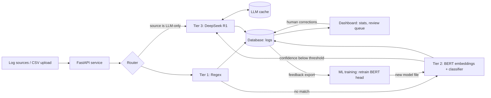

# LogSentinel: Project Guide

A hybrid log classification system combining **Regex**, **BERT embeddings**, and **DeepSeek R1**.
This document covers three things: the problem we are solving, the architecture we chose and why, and everything you need to learn to build it from scratch.

---

## 1. Problem Statement

### 1.1 Context
Every system (web servers, CRMs, databases, cloud platforms, security tools) continuously emits **logs**: short free-text lines describing what happened. A mid-size company can produce millions per day. Examples:

```
User User123 logged in.
192.168.1.5 - - [12/May/2026:10:21:01] "POST /login HTTP/1.1" 401 532
Failed password for root from 10.0.0.5 port 22 ssh2
Escalation rule failed for ticket ID 71234: undefined assignee
The 'ReportGenerator' module will be retired in version 4.0
```

### 1.2 The problem
Raw logs are unstructured and inconsistent. Each source system uses its own wording, so teams cannot easily:

- **Filter and triage**: find security alerts or critical errors among noise.
- **Monitor**: count errors by type, spot trends, build dashboards.
- **Automate**: trigger alerts or tickets based on log type.

Manually labeling logs does not scale, and no single automated technique solves it well:

| Approach | Strength | Weakness |
|---|---|---|
| **Regex / rules** | Instant, free, 100% precise on known patterns | Brittle; misses anything new or reworded |
| **ML classifier (BERT embeddings)** | Generalizes to variations of known categories | Needs a decent amount of labeled data per category |
| **LLM (DeepSeek R1)** | Understands unseen/complex logs with little or no training data | Slow, costly, non-deterministic |

### 1.3 Objective
Build a system that **automatically assigns a category to each log message**, using the cheapest technique that is reliable enough for that log, and that **improves over time** via human feedback.

### 1.4 Categories (initial taxonomy)
`User Action`, `System Notification`, `HTTP Status`, `Security Alert`, `Critical Error`, `Error`, `Resource Usage`, `Workflow Error`, `Deprecation Warning`, plus `Unclassified` as a safe fallback.
The taxonomy is configurable; agree on it early as a team, because everything downstream depends on it.

### 1.5 Scope

**In scope**
- Single, batch, and CSV classification through a REST API
- Three-tier hybrid pipeline with confidence-based routing
- Persistence of every prediction (label, tier, confidence, latency)
- Human review queue and a feedback-to-retraining loop
- Dashboard (overview metrics, try-it box, review queue)
- Evaluation tooling, Docker deployment, CI, tests

**Out of scope (for v1)**
- Training or fine-tuning a large LLM
- Multi-label classification (one label per log)
- Full log management (storage/search at petabyte scale, like Elasticsearch)
- Real-time stream processing at huge throughput (listed as a stretch goal)

### 1.4 Success metrics
1. **Quality:** macro-F1 on a held-out test set, plus accuracy per tier.
2. **Efficiency:** share of logs resolved by regex / BERT / LLM (target: LLM under 10%).
3. **Speed:** average latency per tier; regex+BERT path above ~200 logs/s.
4. **Cost:** number of LLM calls and cache hit-rate.
5. **Real-world accuracy:** accuracy measured on human-reviewed logs in the live system.

---

## 2. General Architecture

### 2.1 Big picture



### 2.2 Routing logic (the heart of the system)

```
if source in LLM_ONLY_SOURCES:        -> R1            (too little data to train on)
else:
    label = regex(message)            -> done if matched
    label = bert(message)             -> done if confidence >= threshold
    label = r1(message)               -> last resort
```

The principle: **cheap and certain first, expensive and flexible last.**

### 2.3 Components

| Component | Location | Responsibility |
|---|---|---|
| **Regex classifier** | `app/classifiers/regex_clf.py`, `config/regex_rules.json` | Ordered list of patterns, first match wins, confidence 1.0 |
| **BERT classifier** | `app/classifiers/bert_clf.py`, `ml/train.py` | Sentence-transformer converts a message to a vector; a Logistic Regression head predicts the category; returns nothing if probability is below threshold |
| **LLM classifier** | `app/classifiers/llm_clf.py` | Prompts DeepSeek R1, strips `<think>` reasoning, parses `<category>` tag, validates against allowed labels, retries on failure, caches results |
| **Pipeline** | `app/classifiers/pipeline.py` | Chooses tiers, measures latency, returns a `Prediction` |
| **API** | `app/api/main.py` | Endpoints for classify, batch, CSV, logs, feedback, stats |
| **Database** | `app/db.py` | `logs` table (predictions + human corrections) and `llm_cache` table |
| **Dashboard** | `dashboard/app.py` | Streamlit UI over the API |
| **ML tooling** | `ml/` | Synthetic data generator, trainer, end-to-end evaluator |

### 2.4 The contract between components
Every tier implements the same interface, so tiers can be developed and swapped independently:

```python
class Classifier:
    def predict(self, source: str, message: str) -> Prediction | None:
        ...  # return a Prediction, or None to pass to the next tier

Prediction = (label, tier, confidence, latency_ms)
```

### 2.5 Data model

**logs**: `id, source, message, label, tier, confidence, latency_ms, reviewed_label, created_at`
**llm_cache**: `key (source + normalized message), label, created_at`

*Normalization* replaces numbers, IPs and UUIDs with placeholders so that "Ticket 123 failed" and "Ticket 999 failed" hit the same cache entry.

### 2.6 API surface

| Endpoint | Purpose |
|---|---|
| `POST /classify` | Classify one log |
| `POST /classify/batch` | Classify up to 1000 logs (parallelized) |
| `POST /classify/csv` | Upload a CSV (`source`, `log_message`), get labeled CSV back |
| `GET /logs` | Query stored logs (filter by label, tier, confidence, unreviewed) |
| `POST /feedback` | Submit a corrected label for a log |
| `GET /feedback/export` | Corrected logs as training CSV |
| `GET /stats` | Counts by tier/label, latency, LLM share, reviewed accuracy |
| `GET /health` | Liveness check |

### 2.7 The learning loop
1. The dashboard shows low-confidence, unreviewed logs.
2. A human corrects labels, which are stored in `reviewed_label`.
3. `/feedback/export` produces a training CSV.
4. `ml/train.py` retrains the BERT head.
5. A promotion gate (to build) deploys the new model only if it scores better on a fixed test set.

Over time more logs are handled by BERT and fewer by R1, which lowers cost and latency.

### 2.8 Key design decisions

| Decision | Reason |
|---|---|
| Frozen sentence embeddings + Logistic Regression, not fine-tuning BERT | Trains in seconds on a laptop, needs little data, strong baseline. Fine-tuning is a later upgrade. |
| Confidence threshold on BERT | Prevents confident wrong answers; routes uncertain logs to the LLM |
| LLM-only sources | Some sources have too few examples to train on; the LLM handles them directly |
| LLM cache with normalized keys | Logs repeat heavily; cuts cost and latency sharply |
| Rules in a JSON file | Non-programmers can add patterns without touching code |
| Fallback to `Unclassified` | The system never crashes when the LLM is down or returns garbage |
| SQLite by default | Zero setup; swap the `DATABASE_URL` for PostgreSQL in production |

---

## 3. What You Need to Learn

Ordered by when you will need it. Each section lists the concepts, why it matters here, and a **checkpoint**: if you can do it, you are ready to move on.

### 3.1 Python foundations (prerequisite)
- Virtual environments, `pip`, `requirements.txt`
- Dataclasses, type hints, protocols/interfaces
- File I/O (CSV, JSON), `csv` module, `pandas` basics
- Exceptions, logging, retries with backoff
- Threads / `ThreadPoolExecutor` (for parallel LLM calls)
- Testing with `pytest`

**Checkpoint:** write a script that reads a CSV, applies a function to each row in parallel, and writes results out, with a test.

### 3.2 Regular expressions
- Literals, character classes, quantifiers, groups, alternation, anchors
- Greedy vs lazy matching, flags (`re.IGNORECASE`)
- Compiling patterns, `search` vs `match` vs `fullmatch`
- Writing patterns for log formats (timestamps, IPs, HTTP request lines)
- Pitfalls: catastrophic backtracking (ReDoS), overly broad patterns

**Checkpoint:** write patterns that extract IP, method, path and status from an Apache access log line.

### 3.3 NLP fundamentals
- Text preprocessing: tokenization, normalization, why logs are different from natural language (IDs, paths, stack traces)
- Bag-of-words and TF-IDF (a useful baseline to beat)
- Word embeddings idea: meaning as vectors, cosine similarity
- Text classification problem setup

**Checkpoint:** classify logs with TF-IDF + Logistic Regression and record the accuracy. This is your baseline.

### 3.4 Machine learning basics (scikit-learn)
- Train/validation/test split and **why leakage ruins results**
- Logistic Regression and `predict_proba`
- Class imbalance, `class_weight`, stratified splits
- Metrics: accuracy, precision, recall, F1, macro vs weighted average, confusion matrix
- Calibration: what a "confidence" really means
- Model persistence with `joblib`

**Checkpoint:** explain why 95% accuracy can be useless on an imbalanced dataset, and read a classification report.

### 3.5 Transformers and BERT
- Attention and the transformer idea (conceptual level is enough to start)
- What BERT is, pretraining vs fine-tuning
- **Sentence embeddings** (`sentence-transformers`, e.g. `all-MiniLM-L6-v2`): why they are better than raw BERT for similarity tasks
- Using embeddings as features for a simple classifier
- Later: fine-tuning with Hugging Face `transformers` and the Trainer API

**Checkpoint:** embed 20 sentences, compute pairwise cosine similarity, and show that similar logs cluster together.

### 3.5b (Stretch) Embedding-based novelty detection
- Distance to nearest known cluster/centroid, k-NN distance, thresholds
- Used to flag **new types of logs** the system has never seen

### 3.6 Large Language Models and prompting
- How LLMs are called via API (chat messages, temperature, tokens)
- **Reasoning models** (DeepSeek R1): they produce a reasoning trace (often in `<think>` tags) before the answer; you must strip it
- Prompt design for classification: closed label set, strict output format, a fallback label
- Output parsing and validation (never trust the raw output)
- Few-shot prompting (adding examples to the prompt)
- Cost, latency, rate limits, timeouts, retries
- The OpenAI-compatible API format (DeepSeek, Groq and Ollama use it, so switching providers is a config change)

**Checkpoint:** call the API with a log, get a category back in a tag, parse it, and handle a malformed reply without crashing.

### 3.7 Backend engineering with FastAPI
- REST concepts, HTTP methods, status codes
- FastAPI routing, request/response models with **Pydantic**, validation
- File uploads, streaming responses
- App factory pattern and dependency injection (makes testing easy)
- Settings management with environment variables (`pydantic-settings`, `.env`)
- Running with `uvicorn`, auto docs at `/docs`
- Testing with `TestClient`

**Checkpoint:** build an endpoint that accepts a CSV upload and returns a processed CSV, with a test.

### 3.8 Databases
- SQL basics: `SELECT`, `WHERE`, `GROUP BY`, aggregates, indexes
- **SQLAlchemy 2.0** ORM: models, sessions, queries
- Why index frequently filtered columns (`label`, `tier`, `source`)
- SQLite vs PostgreSQL; migrations with **Alembic**
- Caching patterns (key design, normalization, invalidation)

**Checkpoint:** model a table, insert rows, and run a grouped count by category.

### 3.9 Dashboard (Streamlit)
- Layout (columns, tabs), widgets, charts
- Calling a REST API with `requests`
- Session state and reruns

**Checkpoint:** a page that calls `/stats` and draws a bar chart.

### 3.10 DevOps and engineering practice
- **Git**: branches, pull requests, code review, conflict resolution
- **Docker** and **docker-compose**: images, volumes, ports, env files
- **CI** with GitHub Actions: run tests on every push
- Secrets handling: never commit API keys; use `.env` and `.gitignore`
- Structured logging, health checks
- Basic load testing (e.g. `locust`)

**Checkpoint:** `docker compose up` brings up API and dashboard from a clean clone.

### 3.11 Data and evaluation skills
- Where to get logs: public collections (e.g. **Loghub**), synthetic generation
- Labeling strategy, label noise, inter-annotator agreement
- Building a **fixed test set** that never changes, so models are comparable
- Error analysis: reading the misclassified examples, not just the score
- Detecting **drift** (label distribution changing over time)

**Checkpoint:** produce a table of accuracy per tier and a list of the 20 worst misclassifications with a hypothesis for each.

### 3.12 Security awareness (relevant to the domain)
- Common log types in security: authentication, SSH, web server, firewall
- What brute-force, port-scan and privilege-escalation entries look like
- Log injection (attackers writing fake log lines) and why inputs must be treated as untrusted
- Don't send sensitive data (passwords, tokens, personal data) to an external LLM; consider masking before the LLM tier
- API security: API keys, rate limiting, input size limits

---

## 4. Suggested Learning and Build Order

| Week | Learn | Build |
|---|---|---|
| 1 | Python foundations, regex, Git workflow, taxonomy and data sources | Repo, CI, regex tier, synthetic data |
| 2 | scikit-learn, metrics, NLP basics, embeddings | TF-IDF baseline, BERT-embedding classifier, evaluation script |
| 3 | LLM prompting, API usage, caching | LLM tier, cache, full pipeline, tests |
| 4 | FastAPI, Pydantic, SQLAlchemy | API, database, CSV endpoint |
| 5 | Streamlit, feedback loop, error analysis | Dashboard, review queue, retraining script |
| 6 | Docker, load testing, documentation | Deployment, benchmarks, final report and demo |

**Split by person:** Dev A leads 3.2 to 3.6, 3.11 and 3.5b (ML side). Dev B leads 3.7 to 3.10 and 3.12 (platform side). Both should understand the other half at the "can explain it" level so you can review each other's pull requests.

---

## 5. Glossary

- **Tier**: one stage of the pipeline (regex, BERT, LLM)
- **Embedding**: a vector of numbers representing the meaning of a text
- **Confidence**: the model's probability for its top prediction
- **Threshold**: minimum confidence required to accept a tier's answer
- **Reasoning model**: an LLM that "thinks" step by step before answering (DeepSeek R1)
- **Active learning**: using human corrections on uncertain examples to improve the model
- **Drift**: change in the data over time that makes a model less accurate
- **Macro-F1**: F1 score averaged equally over all categories, so rare ones count as much as common ones
